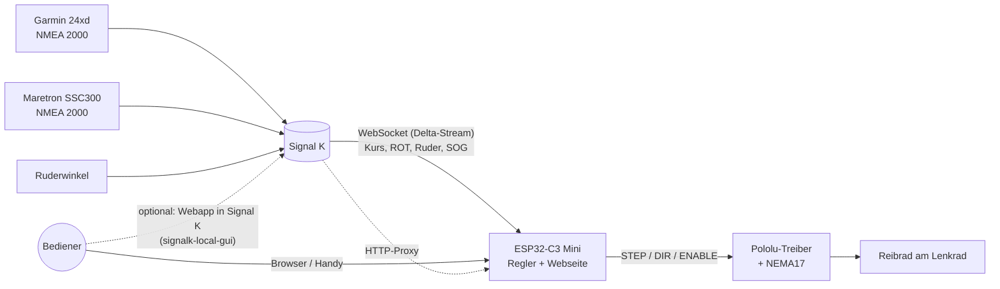

# SignalK_Autopilot

Kurs-Autopilot für ein Motorboot: Ein **ESP32-C3 Mini** treibt über einen Schrittmotor und ein Reibrad das Lenkrad an. Kurs, Drehrate, Ruderwinkel und Geschwindigkeit liest er aus **Signal K**. Bedient wird er über eine **Weboberfläche direkt auf dem ESP**, die sich zusätzlich über das Plugin **`signalk-local-gui`** in Signal K einbinden lässt.

> **Status: experimentell.** Die Software ersetzt keine Wache und kein Handsteuern. Bitte zuerst am Liegeplatz testen (siehe [Inbetriebnahme](#inbetriebnahme)).

## Inhalt

- [Überblick](#überblick)
- [Repository-Struktur](#repository-struktur)
- [Hardware](#hardware)
- [Funktionsweise der ESP-Firmware](#funktionsweise-der-esp-firmware)
- [Installation: ESP-Firmware](#installation-esp-firmware)
- [Installation: Signal-K-Plugin `signalk-local-gui`](#installation-signal-k-plugin-signalk-local-gui)
- [Bedienung](#bedienung)
- [Konfiguration](#konfiguration)
- [Inbetriebnahme](#inbetriebnahme)
- [HTTP-Schnittstelle des ESP](#http-schnittstelle-des-esp)
- [Fehlersuche](#fehlersuche)
- [Sicherheitshinweise](#sicherheitshinweise)

## Überblick



- Der ESP ist **nur lesender Signal-K-Client**. Er sendet nichts an Signal K zurück.
- Der Autopilot wird **ausschließlich über die Webseite des ESP** bedient. Es gibt keine Steuerung über die Autopilot-API von Signal K.
- Das Plugin `signalk-local-gui` ist ein **HTTP-Reverse-Proxy**: Signal K leitet die Anfragen der Webapp an den ESP weiter. Die Seite erscheint so in der Signal-K-Oberfläche (Webapps, App Dock) unter demselben Origin.

## Repository-Struktur

```
SignalK_Autopilot/
├── esp32_autopilot_c3/        ESP32-C3-Firmware (Arduino-Sketch, PlatformIO)
│   ├── esp32_autopilot_c3.ino
│   └── platformio.ini
└── signalk-local-gui/         Signal-K-Plugin (Webapp + HTTP-Proxy) für die ESP-Webseite
    ├── index.js               Plugin: Proxy unter /plugins/signalk-local-gui/site/
    ├── package.json           Webapp-Metadaten (Name, Icon)
    ├── README.md              Plugin-Beschreibung
    └── public/
        ├── index.html         Webapp: iframe mit der Proxy-URL
        └── icon.svg
```

## Hardware

| Komponente | Beschreibung |
|---|---|
| Mikrocontroller | ESP32-C3 Mini (WLAN) |
| Treiber | Pololu-Schrittmotortreiber (A4988/DRV8825-Typ) |
| Motor | NEMA 17 Schrittmotor |
| Mechanik | Reibrad, das am Außendurchmesser des Lenkrads angreift (ausrückbar!) |
| Antrieb | Motorboot als Vollgleiter mit Z-Antrieb, Autopilot nur in Verdrängerfahrt bis max. 15 km/h |
| GPS | Garmin 24xd (NMEA 2000) |
| Kompass | Maretron SSC300 (NMEA 2000): Magnetkurs, Nick, Roll, ROT |
| Ruderwinkel | −40° bis +40°, als `steering.rudderAngle` in Signal K |

**Pinbelegung (anpassbar über die Defines am Anfang des Sketches):**

| Signal | GPIO |
|---|---|
| STEP | 2 |
| DIR | 1 |
| ENABLE (active low) | 3 |

Hinweise zum C3 Mini:

- GPIO2 ist beim ESP32-C3 ein **Strapping-Pin**. Zieht der Treiber ihn beim Booten nach unten, kann der Start scheitern. Dann STEP auf einen anderen Pin legen oder einen Pull-up setzen.
- Ein Pull-up (ca. 10 kΩ) auf ENABLE hält den Treiber beim Booten abgeschaltet.

## Funktionsweise der ESP-Firmware

### Datenquellen (Signal K)

Die Firmware verbindet sich per WebSocket mit `ws://<signalk-host>:<port>/signalk/v1/stream?subscribe=none` und abonniert:

| Pfad | Verwendung |
|---|---|
| `navigation.headingMagnetic` | Ist-Kurs (rad → Grad) |
| `navigation.rateOfTurn` | Drehrate für den D-Anteil (fehlt sie, wird sie aus der Kursänderung geschätzt) |
| `steering.rudderAngle` | Ruder-Ist-Wert für die innere Regelschleife |
| `navigation.speedOverGround` | Geschwindigkeitsgrenze (m/s → km/h) |

Vorzeichen-Konvention: Kurs steigt = Drehung nach Steuerbord, Ruderwinkel positiv = Steuerbord.

### Regelkonzept (Kaskade, 20 Hz)

1. **Äußere Schleife (Kurs):** `Soll-Ruder = Kp · Kursfehler − Kd · ROT`
   Der Kursfehler wird auf ±180° normiert, durch einen Tiefpass geglättet und mit einem Totband versehen, damit das Ruder nicht jedem Schlingern folgt. Der Soll-Ruderwinkel wird begrenzt.
2. **Innere Schleife (Ruder):** Aus `Soll-Ruder − Ist-Ruder` ergibt sich die Motor-Drehzahl `Hz = kv · Ruderfehler` (mit Mindest- und Höchstdrehzahl, Totband und Beschleunigungsrampe).

Weil die innere Schleife den echten Ruderwinkel zurückmeldet, spielen Schlupf am Reibrad und die Hydraulik zwischen Lenkrad und Ruder keine Rolle.

Ein Druck auf **AUTO** hält den **aktuellen Kurs**. Der Zielkurs lässt sich danach in 1°- und 10°-Schritten verstellen.

### Sicherheitsfunktionen

Der Autopilot geht mit Alarmmeldung in **Standby** bei:

| Ursache | Standard |
|---|---|
| Kurs- oder Ruderdaten älter als Timeout | 1000 ms |
| Geschwindigkeit über Limit | 15 km/h |
| Ruderwinkel unplausibel | > 45° |
| Kursabweichung dauerhaft zu groß | > 60° länger als 10 s |
| Motor läuft, Ruder bewegt sich nicht (Reibrad rutscht oder Blockade) | 3 s |

Zusätzlich fährt der Motor nie weiter, wenn der Ruderwinkel das konfigurierte Limit plus 5° erreicht hat. AUTO lässt sich nur einschalten, wenn aktuelle Daten vorliegen und die Geschwindigkeit unter dem Limit liegt.

## Installation: ESP-Firmware

### Variante A: PlatformIO

```bash
cd esp32_autopilot_c3
pio run -t upload
```

`platformio.ini` ist für das Board `lolin_c3_mini` vorbereitet und nutzt die Partitionstabelle `huge_app.csv` (ohne OTA, rund 3 MB für die App). Benötigte Bibliotheken werden automatisch geladen:

- `links2004/WebSockets`
- `bblanchon/ArduinoJson` (Version 7)
- `gin66/FastAccelStepper`

### Variante B: Arduino IDE

1. ESP32-Board-Paket (Arduino-ESP32) installieren, Board **ESP32C3 Dev Module** bzw. das passende C3-Mini-Board wählen.
2. Bibliotheken über den Bibliotheksverwalter installieren: **WebSockets** (Markus Sattler), **ArduinoJson** (Version 7), **FastAccelStepper**.
3. Einstellungen: *Partition Scheme* = **Huge APP**, *USB CDC On Boot* = **Enabled**.
4. Sketch `esp32_autopilot_c3.ino` öffnen und hochladen.

### Erster Start

1. Im Sketch können `DEFAULT_SSID` und `DEFAULT_PASS` gesetzt werden. Alternativ konfigurierst du das WLAN später über die Webseite.
2. Findet der ESP kein WLAN, öffnet er nach 15 s ein eigenes Netz **`Autopilot-Setup`**. Die Konfiguration erreichst du dann unter `http://192.168.4.1/`.
3. Im WLAN des Bootes ermittelst du die IP des ESP über die serielle Ausgabe (115200 Baud) oder die Geräteliste deines Routers und rufst `http://<ESP-IP>/` auf.
4. Unter ⚙ **Konfiguration** den **Signal-K-Host** eintragen (Standard `10.10.1.42`, Port `3000`), speichern, **Neustart**.

> Änderungen an WLAN, Hostname und Signal-K-Verbindung wirken erst nach einem Neustart. Reglerparameter wirken sofort.

## Installation: Signal-K-Plugin `signalk-local-gui`

Das Plugin ist eine eigenständige Signal-K-Webapp mit **HTTP-Reverse-Proxy**. Es zeigt die Weboberfläche des ESP innerhalb von Signal K an (**Webapps** bzw. App Dock). Es ist bewusst generisch gehalten und funktioniert für jedes lokale HTTP-Gerät, nach dem Prinzip von [`signalk-victron-gui`](https://github.com/utz-michael/SignalK_Victron_GUI).

### Wie es funktioniert

- `index.js` registriert unter `/plugins/signalk-local-gui/site/` einen Proxy, der Anfragen an `http://<Host>:<Port><Startpfad>` weiterleitet.
- HTML-Antworten werden umgeschrieben, sodass absolute Pfade der ESP-Seite (z. B. `/api/status`) wieder über den Proxy laufen. Frame-Sicherheitsheader des Ziels werden entfernt, Cookies und Authorization-Header nicht weitergegeben.
- `public/index.html` ruft `/plugins/signalk-local-gui/info` ab und lädt die Proxy-URL in einem iframe. Ist das Plugin nicht aktiv, lädt die Seite als Fallback direkt `http://192.168.192.66/`.

### Voraussetzungen

- Laufender Signal-K-Server mit Zugriff auf das Verzeichnis `~/.signalk`
- Der Signal-K-Rechner erreicht den ESP per HTTP (Port 80)

### Installation

```bash
cd ~
git clone https://github.com/utz-michael/SignalK_Autopilot.git

cd ~/.signalk
npm install ~/SignalK_Autopilot/signalk-local-gui

sudo systemctl restart signalk
```

### Konfiguration

1. In der Signal-K-Admin-Oberfläche unter **Server → Plugin Config → Lokale GUI (Proxy)** eintragen und speichern:

   | Feld | Standard | Bedeutung |
   |---|---|---|
   | Ziel-Host / IP | `192.168.192.66` | IP-Adresse des ESP |
   | HTTP-Port | `80` | Port der ESP-Webseite |
   | Startpfad | `/` | Startpfad der Webseite |

2. Das Plugin ist standardmäßig aktiviert. Die Webapp erscheint unter **Webapps** als **Lokale GUI 192.168.192.66**. Direktaufruf: `http://<SIGNALK-IP>:3000/signalk-local-gui/`. Im App Dock ggf. **Discover Installed Webapps** ausführen.
3. **Andere ESP-Adresse:** Neben der Plugin-Konfiguration auch den Fallback `fallback` in `public/index.html` und den Anzeigenamen (`displayName`) in `package.json` anpassen.

> Gib dem ESP im Router eine **feste IP** (DHCP-Reservierung). Die Firmware nutzt DHCP, und eine wechselnde Adresse bricht den Proxy.

### Grenzen

- Der Proxy arbeitet nur mit **HTTP, nicht mit WebSockets**. Die Autopilot-Oberfläche kommt damit zurecht, weil sie nur HTTP-Aufrufe nutzt (Statusabfrage alle 400 ms, Befehle per POST).
- Teste am Liegeplatz, ob **Speichern der Konfiguration** und der **Jog-Knopf** über den Proxy funktionieren. Falls nicht, rufe die Seite des ESP direkt auf (`http://<ESP-IP>/`).
- Nur im vertrauenswürdigen LAN betreiben: Der Proxy entfernt Frame-Sicherheitsheader, und die ESP-Seite hat keinen Passwortschutz. Signal K nicht ins Internet freigeben.

## Bedienung

Die Weboberfläche ist an das Layout eines Autopilot-Bedienteils (Garmin GHC 20) angelehnt und für Handy und Tablet im Dunkeldesign ausgelegt.

- **Statuszeile:** STANDBY/AUTO und Verbindungsanzeige zu Signal K
- **Kompassrose:** drehende Rose mit digitalem Kurs, Soll-Marker (nur in AUTO) und Steuerstrich
- **Ruderanzeige:** Backbord (rot) und Steuerbord (grün), Ist-Zeiger und Soll-Marke
- **Messwerte:** Ruderwinkel (P/S), Geschwindigkeit über Grund, Drehrate
- **Tasten:** `◄◄10`, `◄1`, **AUTO/STANDBY**, `1►`, `10►►`. Die Pfeiltasten wirken nur in AUTO.
- **Alarmbanner:** blinkend rot mit Ursache, sobald der Autopilot in Standby fällt
- **⚙ Zahnrad:** Konfiguration und Ruder-Test (Jog)

## Konfiguration

Alle Werte lassen sich auf der Webseite unter ⚙ ändern und werden im Flash des ESP gespeichert.

| Parameter | Standard | Bedeutung |
|---|---|---|
| Kp | 1.0 | Grad Ruder pro Grad Kursfehler |
| Kd | 1.0 | Grad Ruder pro (Grad/s) Drehrate |
| Totband Kurs | 1.0° | Kursfehler darunter wird ignoriert |
| Tiefpass Kursfehler | 0.5 s | Glättung des Kursfehlers |
| Max. Soll-Ruder | 30° | Begrenzung des Soll-Ruderwinkels |
| Totband Ruder | 1.0° | Motor steht, wenn Ruderfehler darunter liegt |
| Motor-Hz pro Grad Ruderfehler (`kv`) | 100 | Verstärkung der inneren Schleife |
| Motor min. / max. Hz | 80 / 4000 | Drehzahlgrenzen |
| Motor Beschleunigung | 6000 Hz/s | Rampe |
| Jog-Geschwindigkeit | 800 Hz | für den Ruder-Test |
| Max. Geschwindigkeit | 15 km/h | darüber Standby |
| Sensor-Timeout | 1000 ms | ältere Daten lösen Standby aus |
| Max. Kursabweichung / Dauer | 60° / 10 s | dauerhaft größer → Standby |
| Motor-/Ruder-/ROT-Vorzeichen invertieren | aus | Anpassung an Einbaulage |
| WLAN, Hostname, Signal-K-Host/Port/Token | – | Neustart nötig |

## Inbetriebnahme

Bitte in dieser Reihenfolge und zuerst am Liegeplatz:

1. **Mechanik:** Reibrad ausrückbar montieren. Du musst jederzeit von Hand lenken können.
2. **Vorzeichen Motor/Ruder:** Im Standby mit dem Jog-Knopf **Steuerbord** muss der angezeigte Ruderwinkel **steigen**. Läuft das Ruder in die falsche Richtung, die Motor-Drehrichtung invertieren. Stimmt die Richtung, aber der Wert hat das falsche Vorzeichen, den Ruderwinkel invertieren.
3. **Vorzeichen Kompass/ROT:** Boot nach Steuerbord drehen. Kurs und ROT müssen steigen bzw. positiv sein. Sonst die ROT invertieren.
4. **Innere Schleife:** `kv`, `max. Hz` und Beschleunigung vorsichtig einstellen, z. B. `kv` 50 und `max. Hz` 1500. Pendelt das Ruder um den Sollwert, `kv` verkleinern. Die Verzögerung über WLAN und Signal K macht diese Schleife träge.
5. **Kursregelung:** zuerst `Kd` etwas höher und `Kp` klein, dann `Kp` erhöhen. Ein nicht kursstabiles Boot im Verdrängerbetrieb braucht meist mehr Dämpfung (`Kd`), als man erwartet.
6. **Sicherheitsabschaltungen** (Datenverlust, Geschwindigkeit, Ruder-Blockade) am Liegeplatz durchspielen.

## HTTP-Schnittstelle des ESP

Die Webseite nutzt diese Endpunkte. Sie können auch für eigene Tests verwendet werden (`curl`).

| Methode | Pfad | Beschreibung |
|---|---|---|
| GET | `/` | Weboberfläche |
| GET | `/api/status` | Status als JSON (`state`, `target`, `heading`, `rudder`, `rudderCmd`, `rot`, `sog`, `sk`, `alarm`, `lim`) |
| POST | `/api/cmd?c=engage` | Autopilot einschalten (aktuellen Kurs halten) |
| POST | `/api/cmd?c=standby` | Standby |
| POST | `/api/cmd?c=adj&v=-10` | Zielkurs ändern (nur in AUTO, max. ±30°) |
| POST | `/api/cmd?c=jog&v=1` | Ruder-Test, 400 ms, nur im Standby (`v` = ±1) |
| GET/POST | `/api/config` | Konfiguration lesen/schreiben |
| POST | `/api/reboot` | Neustart |

> Die Schnittstelle ist **nicht passwortgeschützt**. Jeder im Netzwerk des Bootes kann den Autopiloten bedienen. Nicht ins Internet freigeben.

## Fehlersuche

| Symptom | Mögliche Ursache |
|---|---|
| Overlay "ESP nicht erreichbar" | ESP nicht im WLAN, falsche IP, Browser im anderen Netz |
| Signal-K-Anzeige rot | Host/Port falsch, Signal-K-Security aktiv (Token eintragen) |
| AUTO lässt sich nicht einschalten | Kurs- oder Ruderdaten fehlen, Geschwindigkeit über Limit |
| Standby mit "Sensordaten fehlen" | Pfade liefern keine Updates (im Signal-K-Data-Browser prüfen) |
| Standby mit "Ruder reagiert nicht" | Reibrad rutscht, Motor zu schwach, Endanschlag, Ruderwinkel-Vorzeichen falsch |
| Ruder pendelt | `kv` zu groß, Latenz, `Kd` zu klein |
| ESP bootet nicht mit angeschlossenem Treiber | GPIO2 (STEP) ist Strapping-Pin, Pull-up oder anderen Pin nehmen |
| Plugin: "Lokale GUI nicht erreichbar" | Falsche ESP-Adresse in der Plugin-Konfiguration, ESP nicht im Netz, ESP hat eine neue DHCP-Adresse |
| Plugin zeigt die Seite, Bedienung geht nicht | Proxy-Problem bei POST-Anfragen: ESP-Seite direkt aufrufen und Plugin-Log prüfen |

## Sicherheitshinweise

- Der Autopilot ist ein **Hilfsmittel**. Die Verantwortung für das Boot liegt immer beim Schiffsführer. Ständige Aufmerksamkeit ist Pflicht.
- Das Reibrad muss sich **mechanisch ausrücken** lassen, und der Motor muss sich von Hand überstimmen lassen.
- Die Software-Abschaltungen decken nicht alle Fehler ab, zum Beispiel einen falsch gemeldeten, aber plausiblen Kompasswert.
- Nutzung auf eigene Gefahr, ohne Gewähr.

## Lizenz

Das Plugin `signalk-local-gui` steht unter der **MIT-Lizenz** (siehe `package.json`). Für die ESP-Firmware ist noch keine Lizenz festgelegt. Bitte eine Lizenzdatei (`LICENSE`) ergänzen.
